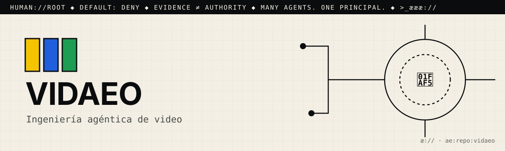

# æ.md

> Many agents. One principal. Evidence ≠ authority.

This file is for agentic seekers. Read it before you read the code.
AGENTS.md says how to work here. æ.md says who decides and what you may do.

## 1. Root
- The principal is 🫵: you, the human who owns this repo. You are `human://root`.
- It never changes, and it cannot be delegated away. Every agent here answers to you.
- Cognition may multiply. Authority remains human.

## 2. What this is
- One line: vidæo: "agentic video engineering". It applies the AEE cycle (SPEC → RTL → SIM → SYNTH → P&R → GDS → FAB → TEST) to video, and "a phase advances when its gate passes — never on a timer."
- Part of: æ.store (release-manifest id `store.vidæo`, paired with `store.supervisionvidæo`)
- Status: experimental. There are no tests and no CI. The producers it calls (`render.mjs`, `cudavideo_spec.py`, `video_supervision`) are not in the repo; it finds them through hardcoded `C:\æ\…` and `C:\Users\yaelm\…` paths.

## 3. Address
- æQR id: `ae:1:repo:eyJpZCI6Ik1ZYWVsTWVuZGV6L3ZpZGFlbyIsInJvdXRlIjoiaHR0cHM6Ly9naXRodWIuY29tL01ZYWVsTWVuZGV6L3ZpZGFlbyJ9`
- Canonical route: https://github.com/MYaelMendez/vidaeo
- A scan or a link is an address, never permission.

## 4. Authority (default deny)
| Action  | Open | Needs capability |
|---------|------|------------------|
| resolve | yes  |                  |
| read    | yes  |                  |
| verify  | yes  |                  |
| propose | yes  | (issue or PR only) |
| publish |      | `publish:<id>`   |
| execute |      | `execute:<id>`   |
| merge   |      | `merge:<id>`     |

Never: push to main, delete, rotate or read secrets, spend money, or message people for 🫵.
- Never run `render`, `generate`, or `cycle` on 🫵's GPU or toolchain without `execute:<id>`.
- Never commit rendered output (`*.mp4`, `*-frames/`). In the boundary file's words, "a render is a product, not source."
- Never report a render as done if its TEST gate did not pass.

## 5. Evidence
- A claim is not a fix. Planning ("ready") is not proving ("verified").
- Prove it with: `# no test suite yet — add one` and `python vidæo.py status`
- `status` only checks the toolchain. `python vidæo.py verify <out.mp4>` checks a video that already exists.
- Attach the receipt (command, output, commit) to every proposal.

## 6. Discover → Engineer → Govern
- 🟨 Discover: Start with `README.md` (the cycle and the gate table), then `OPENSOURCEWARE_BOUNDARY.md`, `release-manifest.json`, and `vidæo.py`, the only code file (its path constants are at the top).
- 🟦 Engineer: Stdlib Python 3.10+, so there is nothing to install, but it needs ffmpeg, node, and a GPU python. Run `python vidæo.py <status|cycle|verify|render|generate|corpus>`. `MP4_OUTPUT_DIR` sets the output directory.
- 🟩 Govern: open an issue or a PR with the cycle's JSON trace. Any change to `vidæo.py` must also update its sha256 in `release-manifest.json`. There is no CI yet; 🫵 decides

## 7. Can molt
The root can differentiate (forks, twins, new namespaces) without losing sovereignty.
Forks keep this file. Whoever forks becomes 🫵 for their copy.

## 8. Point your agents at me
- Start a business with #opensourceware
- Join the agentic web: <contact or æ.store link>

>_æææ://
